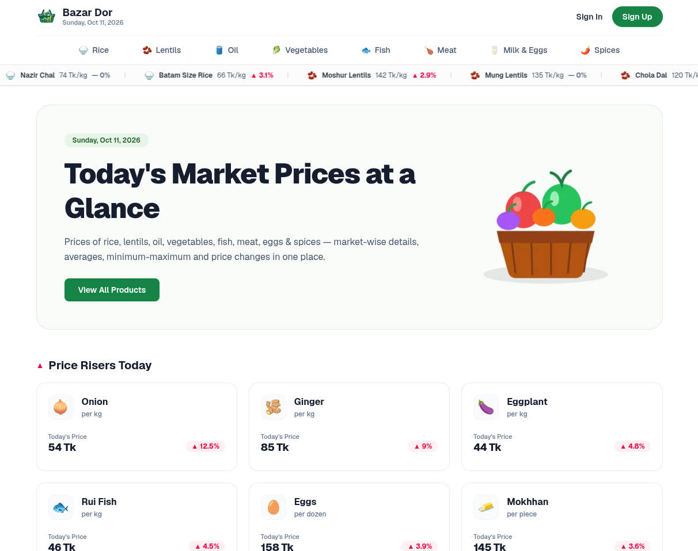

# Bazar Dor (বাজার দর)

A daily market price tracking web application for essential commodities in Bangladesh. It helps everyday shoppers compare prices of rice, lentils, oil, vegetables, fish, meat, and spices across different markets and track daily price changes.

**Live Link:** [https://bazar-dor-xi.vercel.app/](https://bazar-dor-xi.vercel.app/)



## Key Features

1. **Live Price Ticker Marquee:** An infinite scrolling ticker directly below the navbar showing real-time commodity prices and percentage changes.
2. **Daily Price Risers and Fallers:** Instant home page breakdown showcasing today's top 6 products with increased prices and top 6 with decreased prices.
3. **Category Filtering and Numeric Sorting (Challenge C1):** Browse products by category (Rice, Lentils, Oil, Vegetables, Fish, Meat, Eggs & Milk, Spices) and sort items by price (Low to High, High to Low) using numeric values.
4. **Protected Product Details:** Detailed view for each commodity showing Lowest, Highest, and Average prices across 12 division-level markets. Protected route that requires user login.
5. **Authentication and Profile Management (Challenge C3):** Secure authentication powered by BetterAuth supporting Email/Password, Google OAuth, and GitHub OAuth, plus a dedicated profile page to view and update user information.
6. **Loading Skeletons:** Matching skeleton loaders across all views to prevent cumulative layout shift (CLS) while data loads.
7. **Custom 404 Page:** User-friendly Not Found page with quick navigation back to the home page.

## Technologies Used

- **Framework:** Next.js 16 (App Router)
- **Library:** React 19
- **Language:** TypeScript
- **Styling:** Tailwind CSS
- **Authentication:** BetterAuth (Email/Password, Google & GitHub Social Login)
- **Icons:** React Icons (`react-icons/fi`)
- **Notifications:** React Hot Toast
- **Deployment:** Vercel

## Challenges Completed

- **C1 - Price Sorting Dropdown:** Implemented on category pages with options for Default, Price: Low to High, and Price: High to Low, correctly sorting numeric price values.
- **C2 - GitHub Documentation:** Clean, human-written README outlining project goals, live links, preview screenshot, technologies, and setup guide.
- **C3 - Update Information Feature:** User profile page (`/profile`) and update route (`/profile/update`) allowing authenticated users to update their name using BetterAuth's `updateUser` API.

## Getting Started Locally

### 1. Clone the repository
```bash
git clone https://github.com/choyon-dev/Bazar-Dor.git
cd Bazar-Dor
```

### 2. Install dependencies
```bash
npm install
```

### 3. Configure environment variables
Create a `.env.local` file in the root directory and add:
```env
NEXT_PUBLIC_API_BASE_URL=https://openapi.programming-hero.com/api/bazardor
BETTER_AUTH_SECRET=your_auth_secret_here
BETTER_AUTH_URL=http://localhost:3000
GOOGLE_CLIENT_ID=your_google_client_id
GOOGLE_CLIENT_SECRET=your_google_client_secret
GITHUB_CLIENT_ID=your_github_client_id
GITHUB_CLIENT_SECRET=your_github_client_secret
```

### 4. Run development server
```bash
npm run dev
```

Open [http://localhost:3000](http://localhost:3000) in your browser.
